# PFC norepinephrine spectra after IP glucose vs. saline: first pass

*2026-10-27. Code: `spectra/`; the commit is named in [`provenance.txt`](../results/spectra_first5h/provenance.txt). Results: [`results/spectra_first5h/`](../results/spectra_first5h/).*

## Summary

**Goal.** Find out whether an IP glucose injection changes the frequency content of NE fluctuations in the prefrontal cortex (PFC), compared with saline and with each mouse's own pre-injection baseline. The data are fiber photometry with the GRAB-NE sensor.

**Findings.**

- **Slow NE fluctuations drop after glucose in about half the glucose mice.** Fluctuations in the 0.01–0.05 Hz band (swings lasting 20–100 s) became 3–9× weaker for ~2–3 h in 3 of 6 glucose mice (#5, FP1, FP2). They dropped briefly in a 4th (#3, first hour only). None of the 3 saline mice showed a drop.
- On average over the first 2 h after the injection, glucose mice lost about half their slow-band power (÷2.2). Saline mice gained slightly (×1.2).
- **The effect is limited to slow frequencies.** It reaches about 0.1 Hz. From 0.2 to 1 Hz neither group changes.
- **Between 0.05 and 1 Hz, much of the NE channel (465 nm) rises and falls in step with the control channel (405 nm).** The control is the same sensor lit with a colour that doesn't respond to NE. It only picks up things like movement and blood flow. In most mice, 40–90% of the 465 power in this range moves in lockstep with 405 (coherence 0.4–0.9). We therefore suspect that much of the 465 signal there comes from movement or blood flow rather than NE. One case is clearer: right after the glucose injection, a peak near 0.15 Hz appears in both channels, in step, so we strongly suspect it is an artifact rather than an NE response.
- This is a descriptive first pass with 6 vs. 3 mice and no statistics. The drop may reflect less sleep after glucose rather than a direct change in NE dynamics (see [Caveats](#caveats)).

## Dataset

The 9 mice of the glucose study have raw PFC signal. Fiber A (465A / 405A) is treated as PFC. The 465 nm channel is GRAB-NE (`hSyn-NE2m`); the 405 nm channel is the isosbestic control. The sampling rate is ~1017 Hz, and the extraction downsampled it to ~20.3 Hz with anti-aliasing. All 9 recordings start ~09:00 in the light phase (lights 07–19). Only **the first 5 h** of each are used: ~1 h of baseline, the injection, and ~4 h after.

| Mouse | Group | Dose (mL) | Injection (min into recording) | Recording | Raw source |
|---|---|---|---|---|---|
| #3 | glucose | 0.54 | 62.2 | 5 h | `.mat` arrays (pre-extracted) |
| #4 | glucose | 0.56 | 60.6 | 5 h | TDT tank |
| #5 | glucose | 0.60 | 59.4 | 5 h | TDT tank (recovered from OneDrive) |
| #22 | glucose | 0.58 | 58.9 | 5 h | TDT tank |
| FP1 | glucose | 0.52 | 66.5 | 13 h, first 5 h used | `.mat` arrays |
| FP2 | glucose | 0.60 | 59.9 | 13 h, first 5 h used | `.mat` arrays |
| #1 | saline | 0.52 | 60.2 | 5 h | `.mat` arrays |
| #2 | saline | 0.49 | 60.1 | 13 h, first 5 h used | TDT tank (recovered) |
| #33 | saline | 0.54 | 60.8 | 5 h | TDT tank (recovered) |

Groups, doses and injection times come from the experimenter's notebook. The three recovered tanks were checked against their index files and the experimenter's own plots. #33's PFC signal is weak: raw 465 ≈ 69 a.u., against ≈ 260–340 in the other two recovered tanks (#2, #5).

## Methodology

**No single 405 → 465 fit.** The usual correction fits 405 onto 465 and subtracts it. Here it fails (Figure 1). Over the 5 h, 405 bleaches down 15–20% in every mouse. After the injection, 465 instead rises 10–25% in #3, #5, FP1 and FP2. A fit over the whole recording learns a scaling that is too small in every mouse (0.29–0.82, against 0.68–2.61 when fitted on the baseline hour alone). In FP1, #5 and FP2 it comes out zero or negative (−0.01, −0.23, −1.26). Subtracting 405 with a negative scaling *adds* 405 noise. Fitting on the baseline alone is fragile too (#5: −0.16). So no 405 trace is subtracted. 465 and 405 are analysed side by side, and the NE measure uses their coherence instead (below).

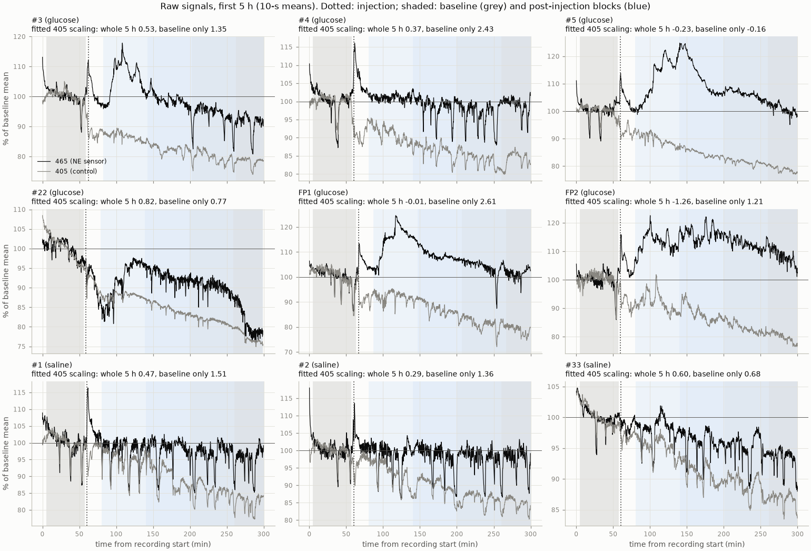

*Figure 1. Raw signals of all 9 mice, first 5 h, as % of each channel's baseline mean (10-s means; black 465, grey 405). Dotted: injection; shaded: the baseline and the four post-injection blocks. Each title gives the 405 → 465 scaling fitted over the whole 5 h and over the baseline only. Two things show directly. First, 405 drifts down while 465 drifts up after glucose. Second, the ~1-min dips (the slow NE oscillation) disappear for 2–3 h after glucose in #5, FP1 and FP2, but continue in the saline mice. Many dips also show in 405, which is why the analysis separates the part of 465 shared with 405.*

**Windows.** The baseline runs from 5 min after the start to 3 min before the injection, ~51–59 min, which skips the start-up transient and the handling. The 20 min after the injection are skipped (handling spike). Four post-injection blocks follow: +20–80, +80–140, +140–200 and +200 min to the 5-h mark (~34–41 min).

**Spectra.** Welch's method with 2-min Hann segments, 50% overlap and a linear detrend in each segment, giving ~0.008 Hz resolution. Before each window's spectrum, each channel is expressed as % of its own mean in that window, which removes slow bleaching of the overall level.

- **Why spectra avoid the fit problem.** The fit fails on drifts over hours: 405 bleaching, and the 465 level rising after glucose. The spectra only see fluctuations *within* each 2-min segment, because each segment is detrended and scaled to its own mean. Those hour-long drifts never enter the spectra. What does enter, alongside NE, are faster artifacts such as movement and blood flow. 405 is still needed to recognise those (next paragraph).
- **Why 2-min segments.** Longer segments resolve slower rhythms; shorter segments give more segments to average, so the spectrum is less noisy. The resolution is 1 / segment length. At 2 min, that is 0.008 Hz, which gives ~5 points across 0.01–0.05 Hz and holds ~2½ cycles of the ~50-s NE oscillation. A ~1-h window still yields ~54–59 overlapping segments to average. With 1-min segments, the resolution (0.017 Hz) could not separate 0.01 from 0.02 Hz. 5-min segments would leave only ~23 segments per window. The 2-min length was not tuned; checking other lengths is a next step.

**Why look at both 465 and 405.** Both channels are the same sensor, at the same spot, lit with two colours of light. At 465 nm the sensor's brightness depends on NE; at 405 nm (the isosbestic point) it does not. Everything else that changes the light affects both: movement of the brain or fiber, blood flow (blood absorbs light), breathing, heartbeat, bleaching. So 465 is roughly "NE + everything else" and 405 is "everything else". The test for artifact is not whether 405 has power at a frequency, but whether it moves *in step* with 465 there. That is measured by coherence (0 = unrelated, 1 = moving in lockstep). Example: right after the glucose injection, both channels show a peak near 0.15 Hz, in step, so it is treated as artifact, not NE. 405 is not perfectly blind to NE, so this may remove a little real NE too (see [Caveats](#caveats)).

**Measures, per window.**

| Measure | What it is | Why |
|---|---|---|
| 465 power | spectrum of the NE-sensor channel | the raw signal |
| 405 power | spectrum of the isosbestic control | shows motion, blood-flow and bleaching changes |
| 465–405 coherence | how predictable 465 is from 405 at each frequency (0–1) | how much of 465 is shared with the control |
| **465 not shared with 405** | P465 × (1 − coherence): the 465 power left after removing the share that moves in step with 405 at that frequency | **main measure.** Not a fit: no 405 trace is subtracted. The shared share is measured separately at each frequency, so no single 405 slope is needed |
| ΔF/F, baseline-only fit | conventional ΔF/F, robust fit on the baseline only | cross-check against the usual approach |

**Frequency range: 0.01–1 Hz.** The ~20 Hz traces carry frequencies up to ~10 Hz. Figure 2 shows each mouse's baseline spectrum over that whole range. [Appendix A](#appendix-a-full-band-view-of-each-recording) shows the full spectrogram of every recording.

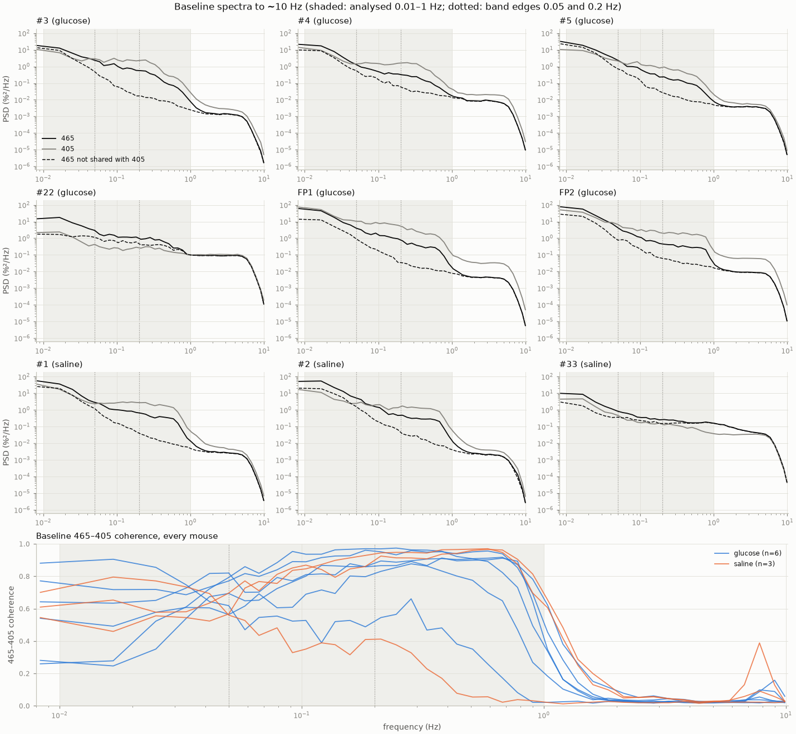

*Figure 2. Baseline spectra (top 3×3: 465 black, 405 grey, and dashed the 465 not shared with 405, i.e. P465 × (1 − coherence), the main measure defined in the table above) and 465–405 coherence (bottom; blue glucose, orange saline), 0.008–10 Hz. Shaded: the analysed 0.01–1 Hz; dotted: the band edges at 0.05 and 0.2 Hz. Data: [`full_band_baseline.csv`](../results/spectra_first5h/full_band_baseline.csv).*

- **Why stop at 1 Hz.** In short: above 1 Hz there is no signal, not a contaminated one. (The range where 465 and 405 are most tangled is 0.05–1 Hz, which is analysed.) In detail: from ~0.8–1.2 Hz upward, the 465 spectrum goes flat: it has hit the noise floor (Table A1). Coherence with 405 falls to 0.02–0.04 there, the level expected from pure chance with ~54 baseline segments. A flat spectrum that is uncorrelated between the two channels is what independent detector noise looks like. Nothing above ~1 Hz can be resolved in either channel. From ~6 Hz both channels roll off steeply. The full-rate (~1017 Hz) data show the same roll-off, so it comes from the acquisition's demodulator low-pass filter, not from our downsampling. The only shared structure above 1 Hz looks like artifact: a ~2–4 Hz trace in #5 from +30 to +90 min (likely breathing or movement) and a steady ~8 Hz band in #2 (likely heartbeat; a mouse's heart beats ~8–10 times a second). The GRAB-NE signal also takes seconds to decay after NE falls, which smooths out faster NE changes.
- **Why stop at 0.01 Hz.** The 2-min Welch segment sets the frequency resolution to 1/120 s ≈ 0.008 Hz. The lowest bin, 0.008 Hz, is less than one cycle per segment. Longer segments would reach lower frequencies but give fewer segments: a ~55-min baseline yields ~54 two-min segments at 50% overlap, and fewer segments means noisier spectra. Below ~0.01 Hz, bleaching and slow drift dominate anyway, and the per-segment linear detrend removes them.

**Bands.** The 0.01–1 Hz range is split into three bands. They were set before the analysis, at roughly even log spacing, and not tuned afterwards. The full change spectra (Figure 4) check that the band edges hide nothing.

- **0.01–0.05 Hz (periods of 20–100 s): the target band.** It contains the infraslow NE oscillation of NREM sleep, at ~0.02 Hz (~50-s cycles; Osorio-Forero et al. 2021, Kjaerby et al. 2022). It is also the most NE-specific part of these recordings. In 8 of 9 mice, it is the only range where 465 has more power than 405 (×1.4 to ×7.9; FP1 ÷1.3), and it has the lowest 465–405 coherence in most mice (0.45–0.79; Table A1).
- **0.05–0.2 Hz: transition.** Coherence climbs from the slow band to its plateau.
- **0.2–1 Hz: shared band.** In 7 mice, 465 here is mostly shared with 405 (coherence 0.72–0.92), so only the part not shared with 405 is read for NE. #22 and #33 have low coherence here (0.36, 0.16), for different reasons. In #22, 405 is close to its noise floor across 0.05–1 Hz. In #33, the weak recording, 465 sits only ~2× above its own high floor from ~0.2 Hz up. In both mice, this band is closer to noise than in the others.

**Summary measure.** Each block is compared with the same mouse's baseline. Tables give fold change: ÷2 = half the power, ×2 = double. Figures plot log2 change, the same thing on a log scale: −1 = half, +1 = double.

## Results

**In short:** in 3 of 6 glucose mice, slow NE fluctuations (swings lasting 20–100 s) shrank 3–9× for 2–3 h after the injection. A 4th glucose mouse dropped for the first hour only. No saline mouse dropped.

**How to read the tables.** Each number compares one post-injection block with the same mouse's own baseline. ÷3 means the power fell to a third, ×1.5 means it rose by half, and ×1.0 or ÷1.0 means no change. Table 1 uses the 465 power not shared with 405: the part of 465 left after removing what moves in step with 405 (see [Methodology](#methodology)). This keeps movement and blood-flow artifacts out of the numbers. Raw 465 gives the same picture for the three strong responders (#5, FP1, FP2: ÷4 to ÷9 in the first two blocks). #3's first-hour drop is mostly seen after the removal: raw 465 falls only ÷1.4 there.

**Table 1. Slow NE fluctuations (0.01–0.05 Hz), 465 power not shared with 405: change vs. the mouse's own baseline.** Bold: a drop of 3× or more.

| Group | Mouse | +20–80 min | +80–140 min | +140–200 min | +200 min–end |
|---|---|---|---|---|---|
| glucose | #3 | **÷3.0** | ÷1.5 | ÷1.1 | ×1.2 |
| glucose | #4 | ÷1.1 | ×1.5 | ×2.1 | ×2.0 |
| glucose | #5 | **÷5.1** | **÷9.4** | **÷3.9** | ÷1.6 |
| glucose | #22 | ×1.9 | ×2.0 | ×2.8 | ×4.6 |
| glucose | FP1 | **÷5.5** | **÷6.0** | ÷1.9 | ÷1.3 |
| glucose | FP2 | **÷3.0** | **÷3.1** | **÷3.4** | ÷2.4 |
| saline | #1 | ×1.6 | ×1.3 | ×1.5 | ×1.6 |
| saline | #2 | ÷1.0 | ×1.3 | ×1.4 | ×1.2 |
| saline | #33 | ×1.1 | ×1.3 | ×1.5 | ×1.5 |

- **#5, FP1, FP2:** ÷3 to ÷9 over the first 2–3 h, partly recovered by the last block.
- **#3:** ÷3 in the first hour, then back to baseline.
- **#4, #22:** no drop; #22 rises steadily (up to ×4.6).
- **Saline:** every block between ÷1.0 and ×1.6.

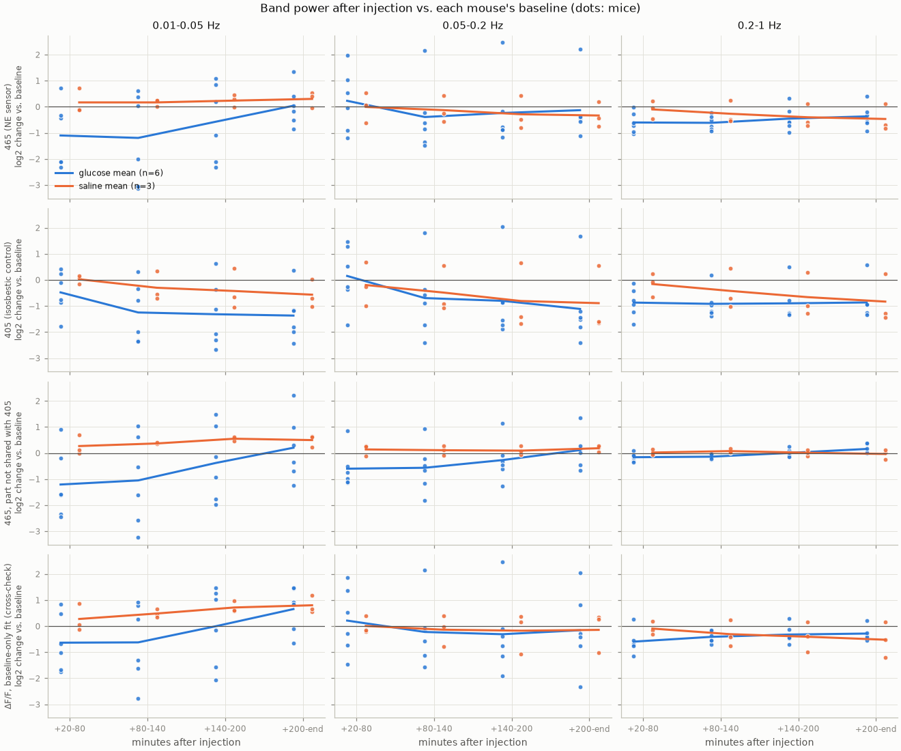

*Figure 3. Table 1 for every measure and band. Rows: measure; columns: band; dots: mice; lines: group means (blue glucose, orange saline). The y-axis is log2 change: −1 = half, −2 = a quarter, +1 = double. The glucose drop is in the 0.01–0.05 Hz column and fades by +200 min.*

**Table 2. Average change over the first 2 h after the injection** (+20–140 min). Averaged on the log scale, i.e. a geometric mean.

| Measure | Band | Glucose (n = 6) | Saline (n = 3) |
|---|---|---|---|
| **465 not shared with 405** | 0.01–0.05 Hz | **÷2.2** | ×1.2 |
| | 0.05–0.2 Hz | ÷1.5 | ×1.1 |
| | 0.2–1 Hz | ÷1.1 | ×1.0 |
| 465 (raw) | 0.01–0.05 Hz | ÷2.2 | ×1.1 |
| | 0.05–0.2 Hz | ÷1.1 | ÷1.0 |
| | 0.2–1 Hz | ÷1.5 | ÷1.1 |
| 405 (control) | 0.01–0.05 Hz | ÷1.8 | ÷1.1 |
| | 0.05–0.2 Hz | ÷1.2 | ÷1.3 |
| | 0.2–1 Hz | ÷1.9 | ÷1.2 |
| ΔF/F, baseline-only fit | 0.01–0.05 Hz | ÷1.5 | ×1.3 |
| | 0.05–0.2 Hz | ÷1.0 | ÷1.0 |
| | 0.2–1 Hz | ÷1.4 | ÷1.1 |

What Table 2 adds:

- **Removing the shared part neither creates nor erases the slow drop.** It is the same size in raw 465 and in the part not shared with 405 (÷2.2 in both), against ×1.1–1.2 in saline.
- **The fast-band drop is not NE.** The 405 control loses power after glucose too (÷1.9 at 0.2–1 Hz). Raw 465 drops at 0.2–1 Hz (÷1.5), but the part not shared with 405 barely changes (÷1.1), so that drop is in the part 465 shares with 405.
- The conventional ΔF/F (baseline-only fit) points the same way, more weakly (÷1.5 vs ×1.3).
- The responders (#5, FP1, FP2) are also the mice whose NE *level* rose most after glucose. In their raw traces (Figure 1), the drop is visible as the ~1-min dips going away while the level is raised.

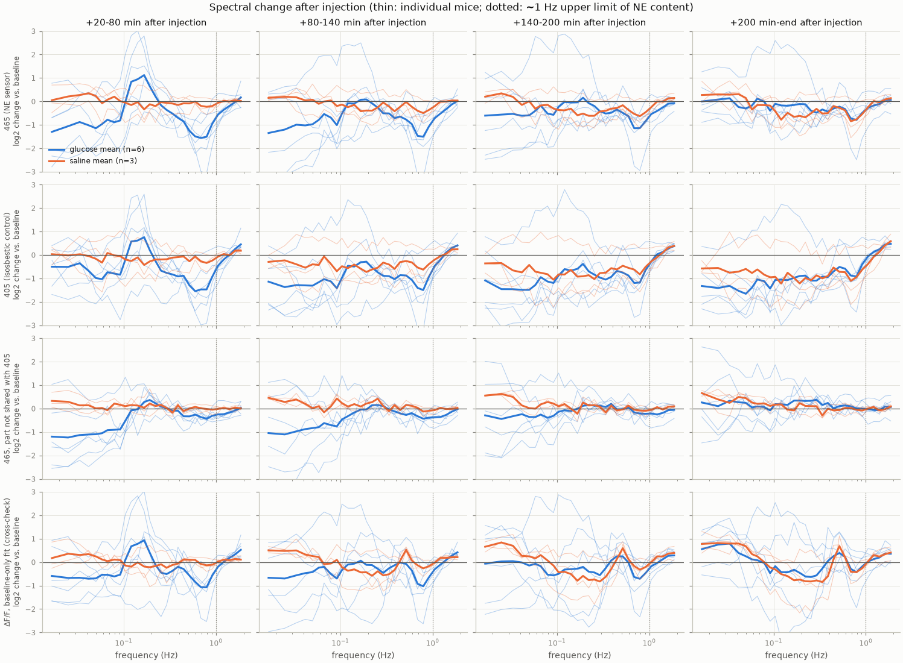

*Figure 4. The change spectrum without bands: log2 change vs. baseline at each frequency, 0.01–2 Hz (−1 = half, +1 = double). Rows: measure; columns: post-injection block; thin lines: mice; thick: group means. Row 3 (465 not shared with 405) shows the glucose drop below ~0.1 Hz in the first two blocks. The +20–80 min peak near 0.15 Hz in rows 1, 2 and 4 is absent from row 3, because it is shared with 405.*

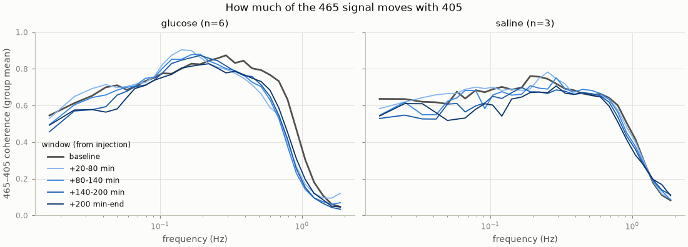

*Figure 5. Group-mean 465–405 coherence by window. Most of the 465 signal at 0.05–1 Hz moves with 405, before and after the injection.*

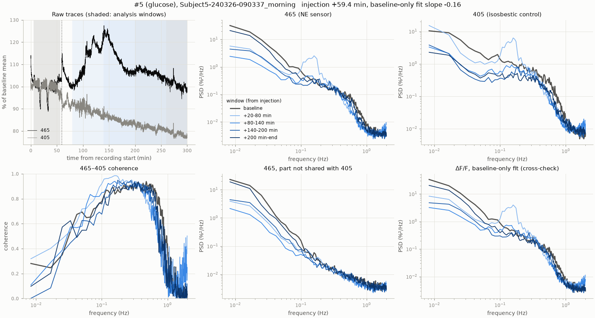

*Figure 6. Mouse #5 (glucose), the clearest responder. Top left: raw traces with the analysis windows shaded. Then each measure's spectrum per window (grey: baseline; blue, light to dark: post-injection blocks). In raw 465 and 405, the first post-injection block has a peak near 0.15 Hz. The 465 not shared with 405 has no such peak, only the drop below ~0.1 Hz.*

Other outputs: per-mouse figures for all 9 mice in [`per_mouse/`](../results/spectra_first5h/per_mouse/), and the tables [`band_power.csv`](../results/spectra_first5h/band_power.csv), [`spectra_logbinned.csv`](../results/spectra_first5h/spectra_logbinned.csv) and [`baseline_fits.csv`](../results/spectra_first5h/baseline_fits.csv).

## Caveats

- **Small n, no statistics.** 6 glucose vs. 3 saline mice. The glucose response is split: 3 strong, 1 brief, 2 none.
- **Sleep state.** Infraslow (~0.02 Hz) NE oscillations are a feature of NREM sleep. Less slow power after glucose may mean the mice slept less, not that glucose changes NE dynamics directly. There is no EEG. The injection itself wakes the mouse, but saline mice don't show the drop.
- **Mouse identity.** FP1 and FP2 (2 of the 3 strong responders) are 13-h sessions recorded in April. Whether FP2 is a repeat of an earlier mouse is still an open question for the experimenter.
- **"Not shared with 405" assumes 405 is a pure control.** If 405 partly picks up NE, which GRAB sensors can do near their isosbestic point, that measure removes some real NE signal. The raw 465 spectrum gives the same direction of effect, which limits this concern.
- **Fiber assignment.** Fiber A = PFC is assumed. For the `.mat`-only sessions (#1, #3, FP1, FP2), the store isn't recorded in the files.
- **Short baseline.** ~1 h limits the slowest reliable frequency to ~0.01 Hz and makes the baseline spectrum itself noisy.

## Next steps

1. **Statistics:** per-mouse changes, with a permutation test on glucose vs. saline or a mixed model across blocks. Report effect sizes; with n = 9, avoid leaning on p-values.
2. **Sleep scoring** from the videos (and NE), then compare spectra within matched states. This is the main confound.
3. **Narrow the band:** look at the ~0.02 Hz NREM NE oscillation peak directly (peak frequency and power), not just band power.
4. **Resolve FP1/FP2 identity and exclusions** with the experimenter (open questions in `questions_for_experimenters.md`).
5. **Relate level to spectrum:** test whether the size of the post-glucose NE level rise predicts the slow-band drop across mice.
6. Optional: repeat on the second fiber (OC) and check sensitivity to block length and segment length.

## Appendix A: full-band view of each recording

Each figure below covers one recording's first 5 h up to ~10 Hz:

- **Left, top two rows:** spectrograms of 465 and 405. These use the same 2-min Hann segments as the analysis, in 1-min steps; each segment is detrended and expressed as % of its own mean. Frequencies are averaged into log-spaced bins (24 per decade). Both rows share one colour scale.
- **Left, bottom row:** 465–405 coherence in sliding 20-min windows (5-min steps). With ~19 segments per window, the no-correlation level is ~0.05.
- **Right:** the baseline spectra and coherence at full resolution.
- **Lines:** vertical lines mark the baseline window, the injection (solid) and the end of the 20-min post-injection skip. Horizontal lines mark 0.01 and 1 Hz.

**Table A1.** Baseline 465–405 coherence by band, 465 power ÷ 405 power in the slow band, and the frequency above which 465 stays within 2× of its noise floor (its 2–5 Hz median). Computed from [`full_band_baseline.csv`](../results/spectra_first5h/full_band_baseline.csv).

| Mouse | Group | Coherence 0.01–0.05 Hz | 0.05–0.2 Hz | 0.2–1 Hz | 2–6 Hz | 465 vs. 405 power, 0.01–0.05 Hz | 465 at noise floor above |
|---|---|---|---|---|---|---|---|
| #3 | glucose | 0.53 | 0.91 | 0.92 | 0.04 | ×1.7 | 1.2 Hz |
| #4 | glucose | 0.57 | 0.68 | 0.72 | 0.03 | ×1.8 | 0.9 Hz |
| #5 | glucose | 0.45 | 0.77 | 0.84 | 0.03 | ×1.9 | 0.9 Hz |
| #22 | glucose | 0.79 | 0.52 | 0.36 | 0.02 | ×7.9 | 0.8 Hz |
| FP1 | glucose | 0.71 | 0.87 | 0.92 | 0.02 | ÷1.3 | 1.2 Hz |
| FP2 | glucose | 0.71 | 0.80 | 0.87 | 0.03 | ×1.4 | 1.0 Hz |
| #1 | saline | 0.52 | 0.81 | 0.92 | 0.04 | ×2.0 | 1.2 Hz |
| #2 | saline | 0.61 | 0.81 | 0.92 | 0.04 | ×4.5 | 1.2 Hz |
| #33 | saline | 0.75 | 0.42 | 0.16 | 0.02 | ×1.9 | 1.4 Hz* |

\* #33's floor is high and slopes gently from ~0.2 Hz, so the 2× rule places it late. By eye, its 465 is near the floor from ~0.2 Hz (see A.9).

What the spectrograms show across recordings:

- Above ~1 Hz, both channels are featureless apart from the artifacts named in [Methodology](#methodology): a shared, drifting ~2–4 Hz trace in #5 from ~+30 to +90 min, and a steady shared ~8 Hz band in #2.
- Below 1 Hz, power changes over time in both channels together. These are the broadband vertical stripes, likely movement. The coherence row shows how much of each change 405 shares.
- Coherence at 0.05–1 Hz stays high across the whole session in most mice. The shared component is not a baseline-only feature.

### A.1 #3 (glucose)
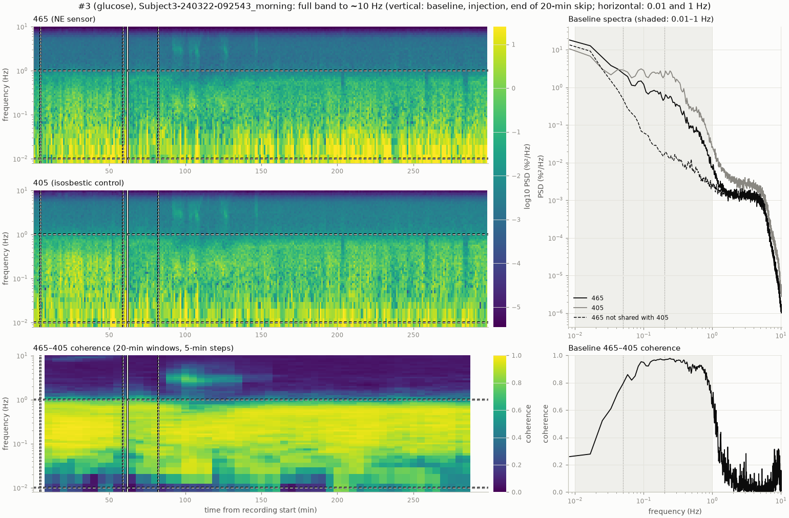

### A.2 #4 (glucose)
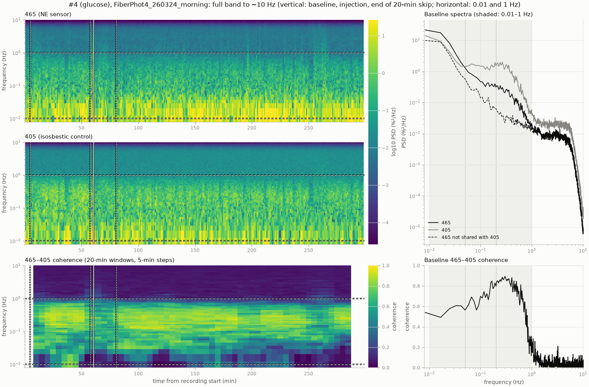

### A.3 #5 (glucose)
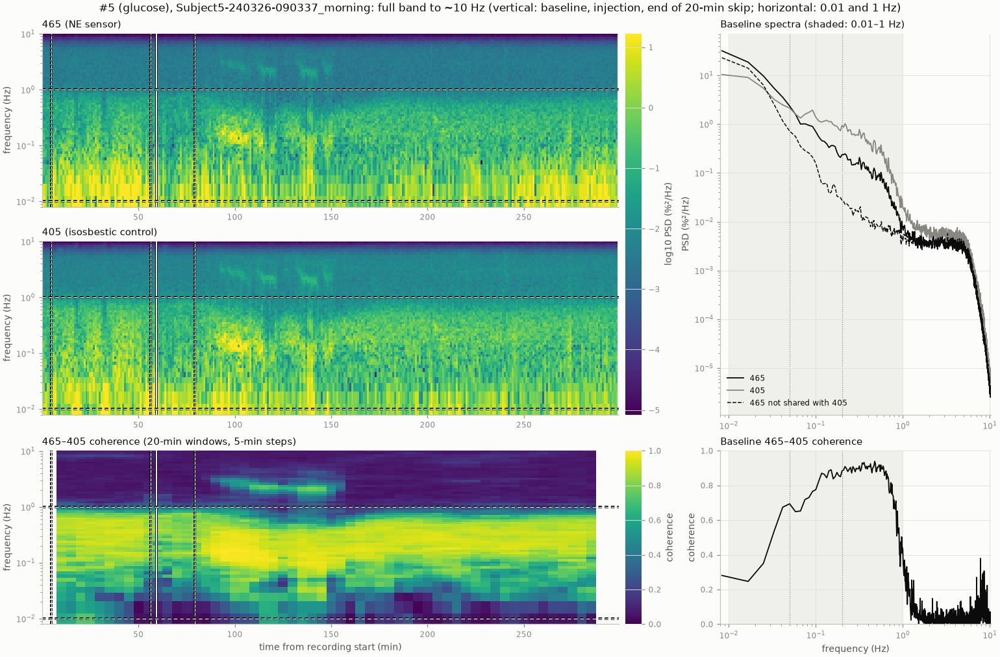

### A.4 #22 (glucose)
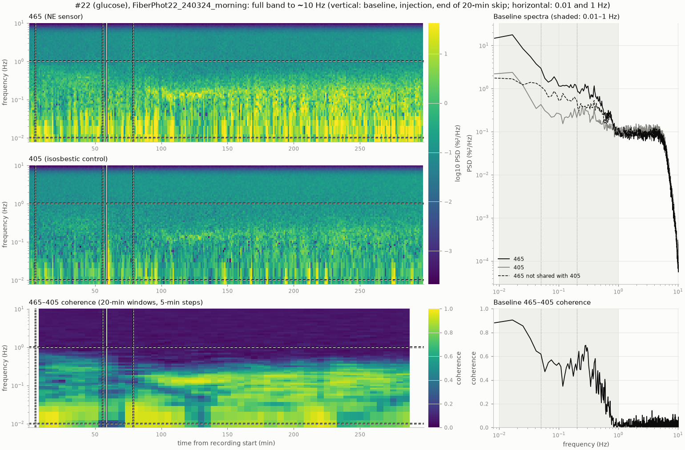

### A.5 FP1 (glucose)
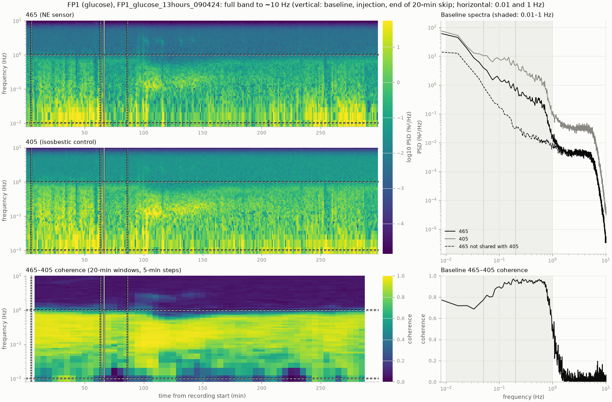

### A.6 FP2 (glucose)
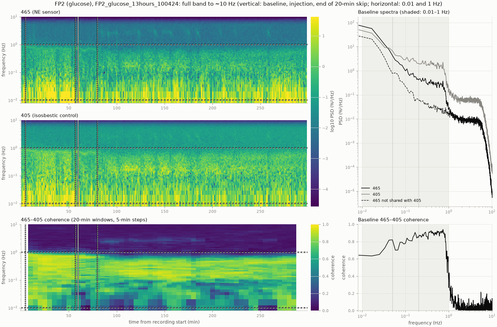

### A.7 #1 (saline)
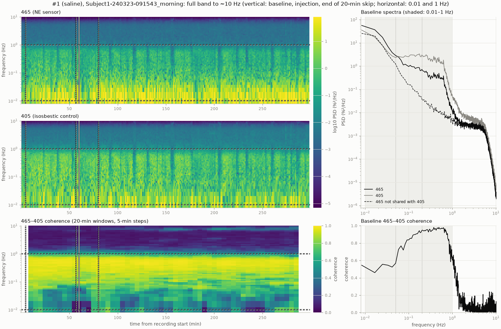

### A.8 #2 (saline)
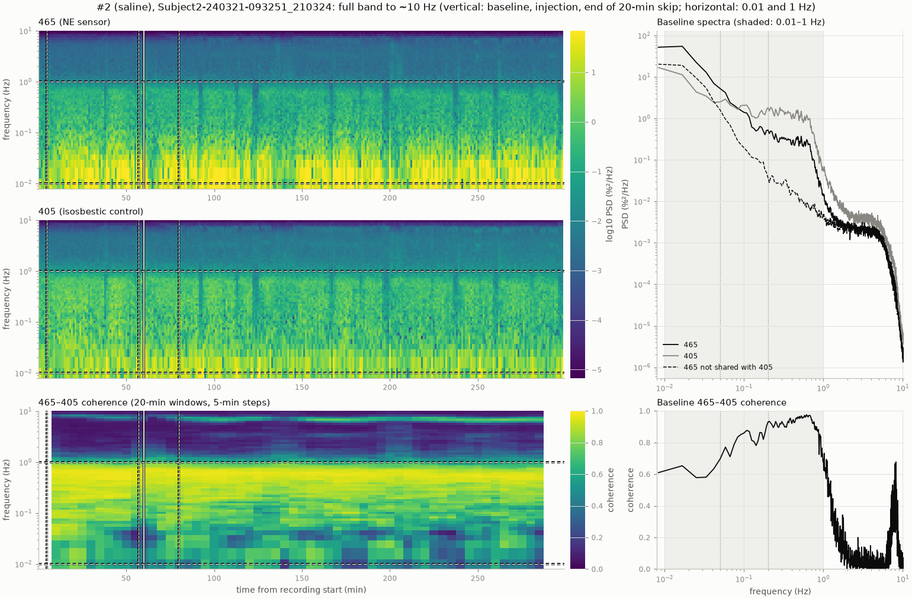

### A.9 #33 (saline)
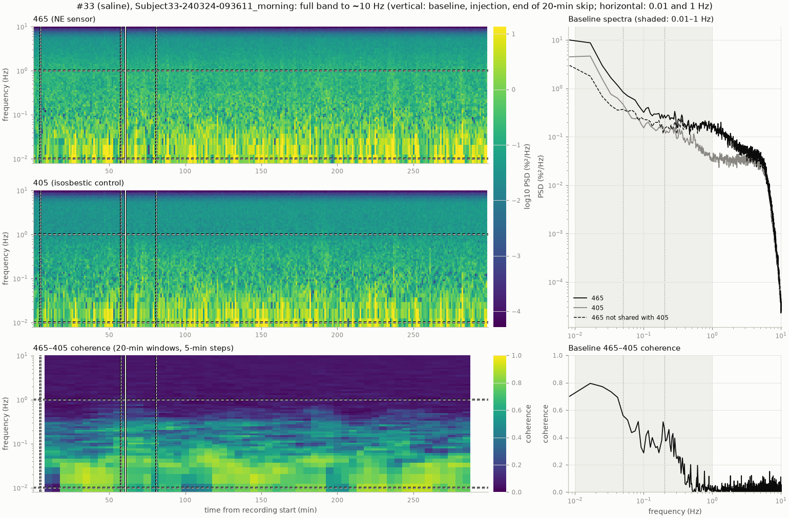

## References

- Osorio-Forero A, et al. (2021). Noradrenergic circuit control of non-REM sleep substates. *Current Biology* 31:5009–5023.
- Kjaerby C, et al. (2022). Memory-enhancing properties of sleep depend on the oscillatory amplitude of norepinephrine. *Nature Neuroscience* 25:1059–1070.
