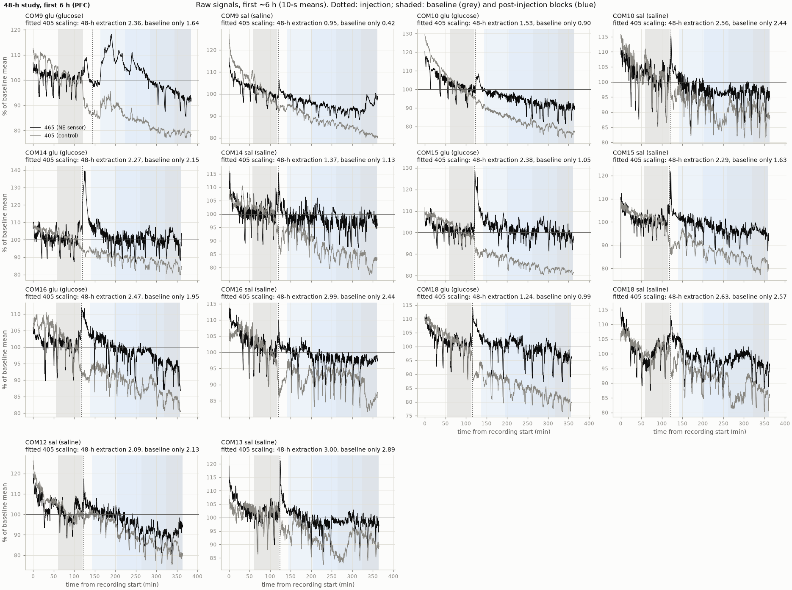
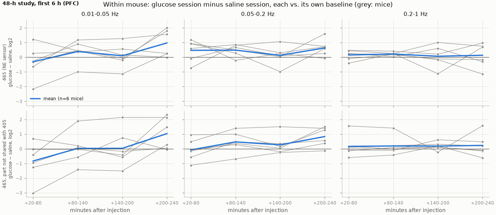

# PFC NE spectra in the 48-h study, first 6 h: glucose vs. saline within mouse

*2026-10-30. Code: `spectra/run_48h_first6h.py`; the commit is named in [`provenance.txt`](../results/spectra_48h_first6h/provenance.txt). Results: [`results/spectra_48h_first6h/`](../results/spectra_48h_first6h/). Companion to the [5-h study report](2026-10-27_first5h_ne_spectra.md), whose method this repeats.*

## Summary

- **One of 6 glucose mice (COM9) shows the strong response seen in the 5-h study.** Its slow NE fluctuations (0.01–0.05 Hz) fell ÷9 in the first hour and stayed ÷3–4 for two more. The ~1-min NE dips disappear from its raw trace for ~2.5 h (Figure 1). Its own saline session shows no such drop. The 5-h study had this response in 3 of 6 glucose mice.
- **The other 5 glucose mice drop only mildly**, ÷1.5–2.1 in the first hour, and their dips continue through the injection.
- **Within mouse, glucose vs. saline:** the first hour after glucose is lower than after saline in 4 of 6 mice (÷1.3–8.1; COM9, COM18, COM14, COM10), equal in COM15 and higher in COM16. The mean is ÷1.8, and without COM9 it is ÷1.3. After the first hour there is no consistent glucose effect.
- **Saline sessions lose slow-band power as the day goes on**, by ÷2.1 on average by +200–240 min (late morning to mid-afternoon), in 405 as well as 465. So a drop vs. baseline alone is not evidence of an effect here; the within-mouse saline session is the reference. Late in the window this drift makes glucose look *higher* than saline (×2.1), which we read as saline-session drift, not a glucose increase.
- Descriptive only: 6 crossover mice (2 male, 4 female), no statistics.

## Dataset and method

The 48-h crossover: each mouse got IP glucose and, 2–3 weeks later, saline (same 20 µL/g volume), both injected at ~11:00, ~2 h into a recording that starts at ~09:00. Two mice per tank, one per fiber, both PFC. 6 mice have both sessions; COM12 and COM13 have saline only (their glucose tank has no raw files). Extraction: `extraction/extract_ne_48h.m` (v2, ~20 Hz), `outputs/ne_48h_ds20/`.

Same measures as the 5-h study (`spectra/core.py`): Welch spectra with 2-min segments of raw 465 and 405, 465–405 coherence, and the 465 power not shared with 405. Two differences:

- **Baseline:** the last hour before the injection, ending 3 min before it. The recordings have ~2 h before the injection, but the first hour may still hold the settling-in after hookup, and one hour matches the 5-h study.
- **Blocks:** the 5-h study's post-injection blocks, +20–80, +80–140, +140–200 and +200–240 min, so the studies compare block by block.

**COM9 glucose:** the journal gives its injection at 11:30, but its signal changes at 11:10, when its tank-mate COM10 was injected, and not at 11:30 (`outputs/ne_48h_ds20/qc/may8_injection_zoom.png`). Its trace from 11:10 has the same bump–dip–rise shape as 5-h mouse #3 right after its injection. Blocks use the journal's 11:30, and the baseline ends at 11:07, which is safe either way. If the injection was at 11:10, each block is 20 min later after injection than its label says. Asked the experimenter (question 8).

## Results

**Table 1. Slow NE fluctuations (0.01–0.05 Hz), 465 power not shared with 405: change vs. the session's own baseline.** Bold: a drop of 3× or more. Italic rows: glucose change divided by saline change, same mouse.

| Mouse | Sex | Session | +20-80 | +80-140 | +140-200 | +200-240 |
|---|---|---|---|---|---|---|
| COM9 | M | glucose | **÷9.3** | **÷3.8** | **÷3.1** | ÷1.4 |
| COM9 | M | saline | ÷1.1 | ÷1.4 | ÷1.1 | ÷1.8 |
| COM9 | | *glucose vs. saline* | *÷8.1* | *÷2.7* | *÷2.8* | *×1.2* |
| COM10 | M | glucose | ÷2.0 | ×1.1 | ×1.9 | ×1.9 |
| COM10 | M | saline | ÷1.5 | **÷3.4** | ÷2.3 | ÷2.4 |
| COM10 | | *glucose vs. saline* | *÷1.3* | *×3.7* | *×4.4* | *×4.4* |
| COM14 | F | glucose | ÷1.5 | ÷1.3 | ÷1.3 | ÷1.7 |
| COM14 | F | saline | ×1.3 | ÷1.3 | ÷1.1 | ÷1.8 |
| COM14 | | *glucose vs. saline* | *÷1.9* | *×1.1* | *÷1.1* | *×1.0* |
| COM15 | F | glucose | ÷1.5 | ÷1.2 | ÷1.4 | ×1.4 |
| COM15 | F | saline | ÷1.5 | ÷1.2 | ÷1.0 | **÷3.5** |
| COM15 | | *glucose vs. saline* | *÷1.0* | *÷1.0* | *÷1.3* | *×5.0* |
| COM16 | F | glucose | ÷1.6 | ÷1.4 | ÷2.6 | ÷2.2 |
| COM16 | F | saline | ÷2.6 | ÷1.6 | ÷1.7 | **÷6.0** |
| COM16 | | *glucose vs. saline* | *×1.6* | *×1.2* | *÷1.5* | *×2.8* |
| COM18 | F | glucose | ÷2.1 | ÷1.4 | ÷1.1 | ÷1.1 |
| COM18 | F | saline | ×1.1 | ×1.0 | ÷1.9 | ÷1.1 |
| COM18 | | *glucose vs. saline* | *÷2.4* | *÷1.5* | *×1.7* | *÷1.0* |
| COM12 | M | saline | ×1.3 | ÷1.3 | ÷1.1 | ÷1.3 |
| COM13 | M | saline | ÷1.5 | ÷1.3 | ÷2.6 | ÷1.4 |
| mean | | glucose (n=6) | ÷2.3 | ÷1.5 | ÷1.4 | ÷1.1 |
| mean | | saline (n=8) | ÷1.2 | ÷1.5 | ÷1.5 | ÷2.1 |
| mean | | *glucose vs. saline (n=6)* | *÷1.8* | *×1.0* | *×1.0* | *×2.1* |

Raw 465 gives the same picture (`band_power.csv`): COM9 glucose ÷5.4, ÷3.4, ÷2.9 in the first three blocks. The 0.05–0.2 and 0.2–1 Hz bands show no consistent glucose effect.

*Figure 1. Raw 465 (black) and 405 (grey), first ~6 h of all 14 sessions, as % of the baseline mean (10-s means). Shaded: baseline (grey) and the four post-injection blocks (blue). Dotted: journal injection time.*

*Figure 2. Within mouse: glucose change minus saline change (log2) by band and block. Grey: each of the 6 crossover mice; blue: mean. Below 0: power fell more, or rose less, after glucose.*

Other figures in the results folder: `band_change.png` (all measures, both groups), `spectral_change.png`, `coherence.png`, `full_band_baseline.png`, and one `per_mouse/` and `full_band/` figure per session.

**Artifact after glucose, again.** COM9's first post-glucose hour has a peak near 0.17 Hz, in step in 465 and 405 (coherence ~0.95). This matches the ~0.15 Hz peak the 5-h report saw right after glucose and treated as an artifact. The 465-not-shared-with-405 measure removes it.

## Comparison with the 5-h study

| | 5-h study | 48-h study, first 6 h |
|---|---|---|
| Strong slow-band drop after glucose (÷3 or more, 2–3 h) | 3 of 6 (#5, FP1, FP2) | 1 of 6 (COM9) |
| First hour only | #3 (÷3) | the other 5, mildly (÷1.5–2.1) |
| Saline | no drop (3 mice) | drifts down over the afternoon (8 sessions) |
| Design | 6 glucose vs. 3 saline, different mice | 6 mice with both (2 male, 4 female), plus 2 saline-only |

The weaker response here could be chance with 6 mice, the different (mostly female) mice, or the 2-h longer time in the rig before the injection. We can't separate these.

## Caveats

- **Time of day and sleep.** The saline drift shows that slow NE power changes over late morning to afternoon without any glucose effect, likely with sleep. There is no EEG/EMG in these tanks, so sleep state can't be controlled. This affects every "vs. baseline" number; the within-mouse glucose–saline difference cancels only the part that repeats across the two sessions.
- **COM9's injection time** is uncertain (above). It is the one strong responder.
- **Session order:** glucose always came first, saline 2–3 weeks later, so condition and order (and age, time since surgery, sensor expression) are confounded.
- n = 6 crossover mice; no statistics.

## Next steps

- Decide with the user whether to run the full 48 h in hourly bins (glucose vs. saline at the same clock time, both dark phases).
- COM9's injection time and the missing COM12/COM13 glucose tank, from the experimenter.
