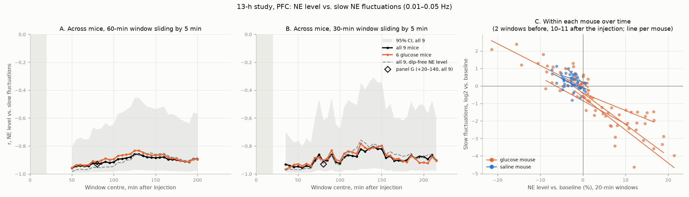
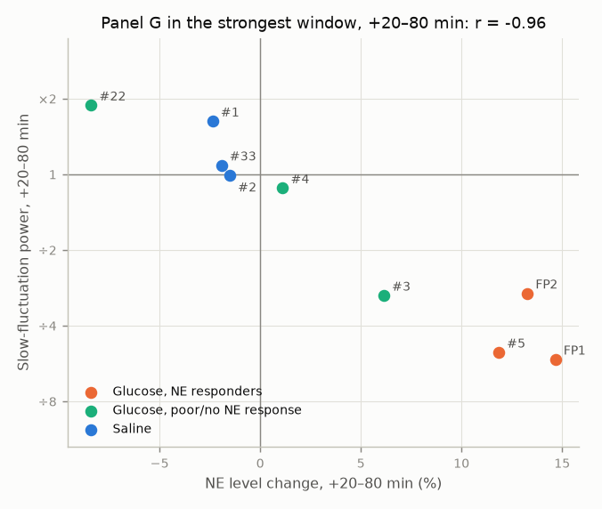

# When is the NE level vs. slow-fluctuation correlation strongest? 13-h study (temporary note)

*2026-11-02. Code: `spectra/window_scan.py` (`python -m spectra.window_scan`); the commit is named in [`provenance.txt`](../results/window_scan_13h/provenance.txt). Results: [`results/window_scan_13h/`](../results/window_scan_13h/). A short working note for the PI's question after the draft figure; to be folded into a later 13-h report.*

## Question

Panel G of the draft figure correlates, across the 9 mice of the 13-h study, the NE level change after the injection with the change in slow NE fluctuations, both over +20–140 min. The PI asked at which time after the injection this correlation is strongest.

## What was done

Same two measures as panel G, each vs. the mouse's own baseline (5 min after the start to 3 min before the injection):

- **NE level:** mean raw 465, % change.
- **Slow fluctuations:** 0.01–0.05 Hz power of the 465 not shared with 405, fold change.

Panel G's correlation was recomputed in 60-min windows, moved in 10-min steps from +20 min (after the handling period) to the end of the shortest recordings: +20–80, +30–90, … +170–230 min. 60 min matches the report's blocks and is about as long as the baseline (~51–59 min), so each window's power estimate is about as precise as the baseline it is compared with.

*Figure 1. Panel G's r (all 9 mice) in each 60-min window, plotted at the window start.*

## Findings

- **No window stands out.** r stays between −0.86 and −0.96 throughout. It is slightly strongest in the first hour (+20–80 min: −0.96) and weakest at +100–160 min (−0.86), but with 9 mice these differences are within what chance alone would give, so none of the windows is better than another. Panel G's own window gives −0.93.
- **The same relation holds within each glucose mouse over time.** Cutting each mouse into 20-min windows (2 before the injection, 10–11 after), stretches with higher NE have less slow-fluctuation power: r = −0.66 to −0.88 in all 6 glucose mice, poor responders included (in #22, NE falls and slow power rises). So the correlation is not only some mice differing from others. In saline mice it is weaker (−0.29 to −0.66), as their NE level hardly moves.
- **Panel G in the strongest window (Figure 2).** Panel G redrawn for +20–80 min, with the draft figure's groups and colours. The picture is the same as in panel G. The one visible change is #3, which sits closer to the responders here (+6%, slow power ÷3.0, vs. +2.6% and ÷1.8 over +20–140 min), because its NE rise is mostly in the first hour.

*Figure 2. Each mouse's NE level change (x) vs. its slow-fluctuation power (0.01–0.05 Hz, y), both over +20–80 min and vs. the mouse's own baseline. Same measures as panel G.*

Side checks (numbers in the CSVs):

- 20- and 30-min windows give the same picture (r −0.75 to −0.96).
- The 6 glucose mice alone give the same picture as all 9.
- **The dips don't explain it.** Each NE dip lowers the mean level and is itself slow-band power, so fewer dips alone would raise one and lower the other. Measuring the level between the dips (90th percentile of 10-s means) instead gives as strong a correlation (−0.98 in the panel G window).
- Leaving out any one mouse: r −0.91 to −0.98 in the panel G window; without the 3 responders, −0.88.

## Interpretation

The correlation looks less like a property of one time window than like a coupling between NE level and slow NE fluctuations, along which glucose responders move the furthest. One possible reading is sleep vs. wake: ~1-min NE oscillations are a feature of NREM sleep, and NE is higher during wake. There is no EEG/EMG here to test this.

## Caveats

- **9 mice, descriptive.** Correlation, not direction.
- **The NE level is raw 465, with no 405 correction.** It includes the slow bleaching over the session (405 falls 15–20% over 5 h). The 405 → 465 fit is now in a [separate report](2026-11-03_13h_fitted_ne_level_spectra.md). It would move the level axis up, more in glucose mice than in saline mice and more late in the session. This note has not been redone with it.
- **Same baseline for both axes.** Noise in a mouse's baseline moves both measures. The within-mouse result argues against this being the main driver.
