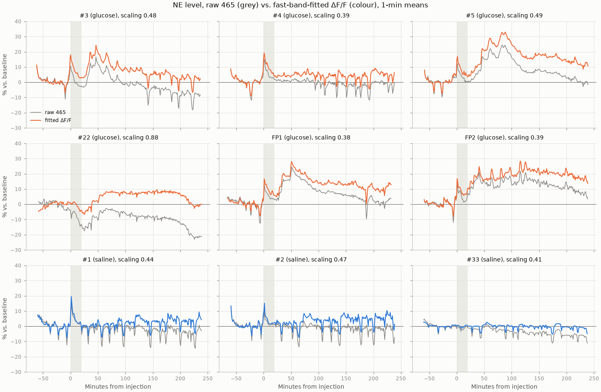
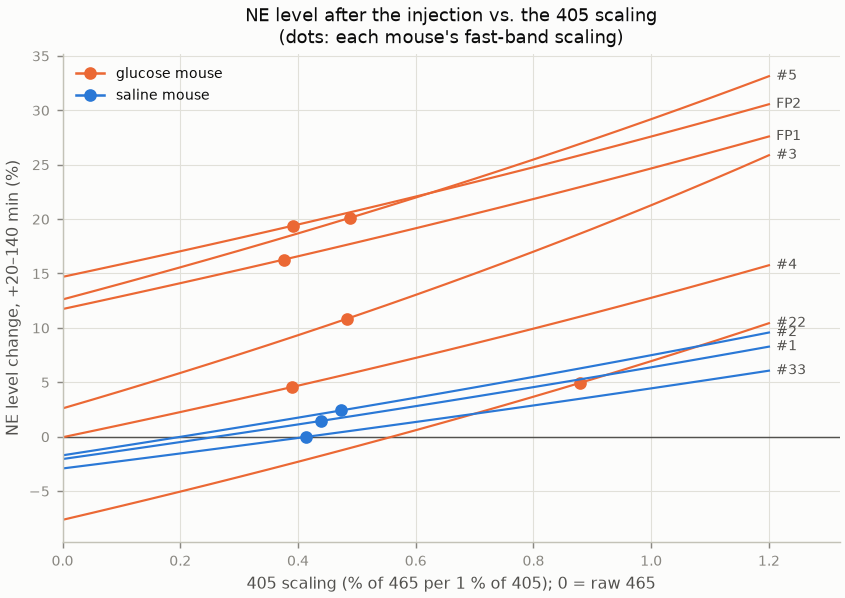
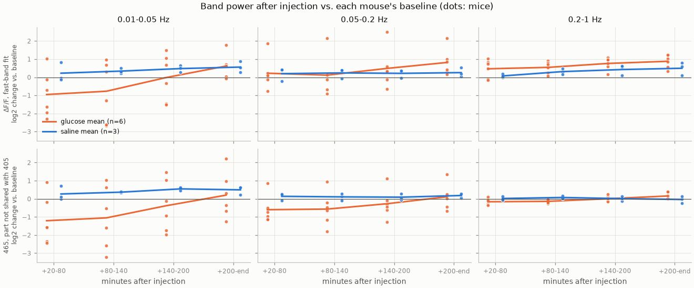

# NE level and spectra with a 405 → 465 fit, 13-h study, first 5 h

*2026-11-03. Code: `spectra/run_first5h_fit.py` (`python -m spectra.run_first5h_fit`, `--fiber oc`); the commit is named in [`provenance.txt`](../results/spectra_first5h_fit/provenance.txt). Results: [`results/spectra_first5h_fit/`](../results/spectra_first5h_fit/), OC in [`results/spectra_first5h_fit_oc/`](../results/spectra_first5h_fit_oc/). A separate experiment next to the [first 13-h report](2026-10-27_13h_first5h_ne_spectra.md). Only the 405 correction is new. Data, windows, spectra and bands are as described there and are not repeated here.*

## Summary

**Question.** The first report used no 405 → 465 fit, because the usual fit failed. Can a sensible fit be made, and does it change the direction of the NE level after the injection, especially in the glucose mice that showed little or no rise?

**Answers.**

- **A fit works if its scaling is learned from fast fluctuations (0.2–1 Hz), not from the slow ones.** There, 465 moves 0.38–0.49% per 1% move of 405 in 8 of 9 mice. The value is the same in other fast bands and after the injection.
- **With the fit, saline mice stay near their baseline** (0 to +2.4% over the first 2 h), and **every glucose mouse but #22 ends up above them.** The usual "responders" rise further (#5, FP1, FP2: +16 to +20%).
- **#3 becomes a clear responder:** +13% in the first hour (raw: +6%).
- **#4 moves from 0% to +4.5%,** a little above the saline mice (0 to +2.4%). It stays above them whatever scaling is used, but the gap is small.
- **#22 can't be decided.** Its own scaling is unreliable. Depending on the value, its level ranges from −2% to +5%.
- **Why the fit changes things:** after a glucose injection, 405 drops more than after saline (−10 to −15% vs. −7 to −9% over the first 2 h). Some light loss unrelated to NE comes with glucose, and in raw 465 it hides part of the NE rise.
- **Slow fluctuations: the drop in #5, FP1 and FP2 holds with the fit** (÷3 to ÷5). #3's smaller drop does not.

## Methodology: the fit

**What a 405 fit does.** 405 is the control channel: the same sensor lit with a colour that doesn't respond to NE. It still picks up everything else that changes the light, such as bleaching, movement and blood flow. A fit predicts from 405 how much of 465 is that non-NE part. This prediction is the *control*, and the NE signal is what 465 does beyond it: ΔF/F = 465 / control − 1. The usual control is a straight line, control = a × 405 + b.

**The scaling is `a`, in % units.** Raw brightness differs a lot between mice (baseline 465 from ~41 a.u. in #22 to ~483 in #3), so a raw `a` can't be compared across mice. The scaling expresses the same coefficient as "465 moves this many % for every 1% that 405 moves". The two convert as:

  a = scaling × (465 baseline mean ÷ 405 baseline mean),  b = 465 baseline mean × (1 − scaling)

For example, #5's scaling of 0.49 is a = 0.67 and b = 127 in raw units. Both forms are in `fits.csv`. Written with the scaling, the control is: control = 465 baseline mean × (1 + scaling × % change of 405 vs. its baseline). So when 405 sits at its baseline, the control equals 465's baseline, and when 405 drops 10%, the control drops scaling × 10%.

- Scaling 0 means no correction (raw 465).
- Scaling 1 means 465 and 405 lose the same fraction of light, i.e. dividing 465 by 405.
- Everything that follows is about choosing a value in between.

**Why the usual way of choosing `a` failed.** The usual fit picks `a` and `b` by least squares on the raw traces. But 465 follows 405 with a different strength at different time scales (`fits.csv`):

| Time scale | Scaling (8 of 9 mice) | What dominates there |
|---|---|---|
| Hours (whole session) | small or negative (first report) | 405 bleaching down while 465 rises after glucose |
| ~1-min dips (0.01–0.05 Hz) | 0.7–1.6 | the NE dips, which line up with 405 dips |
| Fast (0.2–1 Hz) | 0.38–0.49 | movement and blood-flow artifacts, little NE |

A least-squares fit is pulled toward whichever time scale has the biggest swings. On the whole session that is the hours row: the glucose rise in 465 against 405 bleaching makes `a` too small or negative. On the baseline hour it is the dips row: real NE dips that happen to line up with 405 dips make `a` too large. In both cases the fit is partly fitting NE, which is exactly what the control must not contain.

**How the scaling is chosen here.** It is learned from fast fluctuations (0.2–1 Hz) during the baseline. NE contributes little at these speeds, because the sensor responds too slowly and the NE dips are much slower. 465 and 405 move together there (coherence 0.7–0.9 in most mice), so the fast band shows how a non-NE change in light carries over from 405 to 465. In practice:

1. Take the baseline window of both channels.
2. Express each as a fraction of its own mean.
3. Band-pass both to 0.2–1 Hz.
4. Regress 465 on 405 (least squares). The slope is the scaling.
5. Build the control from the whole 405 trace with that scaling, and compute ΔF/F.

The key assumption is that slow non-NE light changes (bleaching, and the extra 405 drop after glucose) carry over to 465 with the same scaling as the fast ones. Nothing in the data measures the slow scaling directly. Figure 2 below shows how much each mouse depends on it.

**Checks on the scaling** (`fits.csv`):

- **Same in other fast bands.** 0.1–1 Hz and 0.5–1 Hz give the same value within 0.03 in 7 mice.
- **Same after the injection.** +20–140 min gives 0.41–0.58, against 0.38–0.49 at baseline.
- **Exceptions.** #22 (next paragraph) and #33, a weak recording, which gives 0.18 at 0.5–1 Hz.
- **Saline stays near its baseline.** Over 4 h, the fitted saline level stays between −1% and +5% (Table 1). Over the last hour, saline 465 falls 3–6% while 405 falls 13–17%, a ratio of 0.2–0.5. The fast-band scaling (0.41–0.47) is at the upper end of that, so late in the session the fit may over-correct by a few %.

**The outlier: #22.** #22's level can't be decided with this fit, for two reasons that come together.

- **Its level flips sign within the plausible range of scalings.** Over +20–140 min it is negative below a scaling of ~0.55 and positive above (−1.6% at 0.45, +4.9% at 0.88; Figure 2). The other glucose mice keep the same sign anywhere between 0.4 and 1.0.
- **Its scaling can't be pinned down.** The estimate depends on the band: 0.88 at 0.2–1 Hz (the standard), 0.98 at 0.1–1 Hz, 0.43 at 0.5–1 Hz, and 0.48 after the injection. In the other mice except #33 these agree within ~0.1.
- **Why the estimate is unstable.** #22 is by far the dimmest recording (baseline 465 ≈ 41 a.u., 405 ≈ 31, against 71–483 and 44–306 in the other mice). In the first report, its 405 sat near the noise floor across 0.05–1 Hz. Much of the fast 405 signal the fit learns from is detector noise rather than shared light changes, and some shared component between 0.1 and 0.5 Hz pulls the estimate up. Why its channels relate differently from the other mice is not known.
- **What hinges on it: a drop in both channels around the injection.** It starts ~10 min before the injection, so it looks like handling or a shift in the light path rather than NE. Then 465 recovers while 405 stays down:

| Minutes from injection (5-min means, bin start) | −10 | +20 | +55 |
|---|---|---|---|
| 465 vs. baseline | −3.5% | −15.6% | −5.2% |
| 405 vs. baseline | −4.2% | −12.3% | −11.8% |

A scaling near 0.9 treats almost all of the shared fall as non-NE, so 465's later recovery reads as an NE rise. A scaling near 0.45 removes only half of it, so part of the fall stays in the NE trace. The data can't tell these apart, so #22 is left undecided. Something may be wrong with this recording, but nothing here shows it, and the experimenter excluded no sessions.

## Results

### NE level

**Table 1. NE level vs. the mouse's own baseline (%).** Raw columns are the uncorrected 465 and 405 means over +20–140 min. The fitted ΔF/F is shown per block.

| Group | Mouse | Scaling | 405 raw, +20–140 | 465 raw, +20–140 | **Fitted, +20–140** | +20–80 | +80–140 | +140–200 | +200–end |
|---|---|---|---|---|---|---|---|---|---|
| glucose | #3 | 0.48 | −15.4 | +2.6 | **+10.8** | +13.4 | +8.2 | +4.0 | +2.0 |
| glucose | #4 | 0.39 | −11.3 | −0.1 | **+4.5** | +4.8 | +4.3 | +3.1 | +5.5 |
| glucose | #5 | 0.49 | −12.7 | +12.6 | **+20.1** | +17.8 | +22.4 | +16.8 | +12.6 |
| glucose | #22 | 0.88* | −13.6 | −7.7 | **+4.9** | +2.5 | +7.3 | +8.0 | +1.5 |
| glucose | FP1 | 0.38 | −10.4 | +11.7 | **+16.3** | +18.2 | +14.3 | +11.9 | +10.4 |
| glucose | FP2 | 0.39 | −10.0 | +14.7 | **+19.4** | +17.0 | +21.8 | +20.8 | +17.6 |
| saline | #1 | 0.44 | −7.8 | −2.1 | **+1.4** | +0.0 | +2.8 | +2.9 | +3.0 |
| saline | #2 | 0.47 | −8.5 | −1.7 | **+2.4** | +1.7 | +3.1 | +4.7 | +4.9 |
| saline | #33 | 0.41 | −7.0 | −2.9 | **−0.0** | +0.1 | −0.1 | −0.5 | −1.3 |

\* unreliable (see [The outlier: #22](#methodology-the-fit)); at the typical 0.45, #22's fitted +20–140 level is −1.6%.

*Figure 1. NE level per mouse, 1-min means, % vs. baseline. Grey: raw 465. Colour: fitted ΔF/F. Shaded: injection and handling (first 20 min).*

- **Every mouse moves up with the fit,** because 405 falls in every mouse. The question is whether glucose mice move further than saline mice.
- **They do, because their 405 falls more** (−10 to −15% vs. −7 to −9%). This extra loss is not bleaching, which doesn't depend on the injection. It is already visible in the first 40 min after the injection. What causes it isn't known; a change in blood flow or volume under the fiber is one possibility.
- **Direction changes:** #3 goes from a brief small rise to a clear one. #4 goes from flat to a small rise. #22 goes from a fall to around zero. The saline mice go from slightly below baseline to about baseline.

*Figure 2. NE level change over +20–140 min as a function of the 405 scaling, one line per mouse. Left edge: raw 465 (no correction). Dots: each mouse's own fast-band scaling.*

- **The order of the mice barely depends on the scaling.** #4 is above every saline mouse at any scaling from 0 to 1.2. #22 stays below or among them at every scaling. So the fit doesn't create the difference between #4 and saline; it makes the difference larger.

### Slow fluctuations (0.01–0.05 Hz)

**Table 2. Slow-band power over +20–140 min vs. baseline, fold change: fitted ΔF/F vs. the first report's main measure (465 not shared with 405).**

| Mouse | #3 | #4 | #5 | #22 | FP1 | FP2 | #1 | #2 | #33 |
|---|---|---|---|---|---|---|---|---|---|
| Fitted ΔF/F | ÷1.2 | ×1.2 | **÷5.0** | ×2.0 | **÷5.5** | **÷2.8** | ×1.6 | ×1.1 | ×1.1 |
| Not shared with 405 | **÷2.1** | ×1.2 | **÷6.9** | ×2.0 | **÷5.7** | **÷3.0** | ×1.4 | ×1.1 | ×1.2 |

Group means (geometric): glucose ÷1.8 with the fit (÷2.2 not shared), saline ×1.2 (×1.2).

- **The slow drop in #5, FP1 and FP2 doesn't depend on the correction.**
- **#3's drop goes away with the fit.** It was in the part of 465 shared with 405, which the fit removes only partly (scaling 0.48, while the dip-band coupling is 0.80).
- So with the fit, #3 is a mouse whose NE level rises but whose slow fluctuations barely change. In the other responders, both change.

*Figure 3. Band-power change per mouse and block (log2: −1 = half, +1 = double). Top: fitted ΔF/F. Bottom: 465 not shared with 405, as in the first report.*

- **Above 0.05 Hz, the fitted ΔF/F is not a good NE measure.** In #3, #5, FP1 and FP2, its 0.2–1 Hz power rises ×1.5–1.8 after glucose, while the part not shared with 405 stays flat. After subtraction, what remains in the fast band is a small leftover, so a small shift in how 465 follows 405 after the injection changes it a lot. For spectra, the measure "not shared with 405" stays the main one.

### Side check: the OC fiber

The OC scaling is less consistent across bands (0.5–1 Hz gives 0.09–0.34, lower than 0.2–1 Hz), so these numbers are rougher. Over +20–140 min, fitted OC level: FP1 +15%, FP2 +16%, #22 +17%, #3 +7%, #4 +5%; saline −2 to +2%. #5's OC fiber is weak and falls (−4%). In #22, the OC level rises even without the fit (+14%), although its PFC level does not.

## Caveats

- **One scaling for every time scale.** The fit assumes that slow light loss (bleaching, and the extra 405 loss after glucose) carries over to 465 with the same strength as fast artifacts. Nothing measures the slow coupling directly. The saline ratio (0.2–0.5) suggests it may be a bit smaller, which would lower all fitted levels by a few % late in the session. Figure 2 shows how much each mouse depends on it.
- **The extra 405 drop after glucose is unexplained.** If it comes from something that affects 405 more than 465 (e.g. blood absorbs more light at 405 nm), the fit over-corrects glucose mice. #4's small rise (+4.5%) is within that uncertainty; #3's (+13% in the first hour) is not.
- **Could the extra 405 drop be NE itself?** Suggested in the lab after this report: 405 nm may not be exactly the wavelength at which the sensor ignores NE, so a strong NE rise could lower 405, as TDT describes for GCaMP. The fit would then count part of the NE rise twice. Two checks in these data argue against it, though neither settles it:
  - At the ~1-min NE dips, 405 moves the same way as 465 in all 9 mice (scaling 0.7–2.4, `fits.csv`). This mechanism predicts the opposite.
  - Across glucose mice, 405 doesn't drop more where 465 rises more (+20–140 min): FP1 and FP2 (raw 465 +12 to +15%) lose the least 405 (−10%), and #3 (+3%) loses the most (−15%).
  - Feng et al. (2024) also found GRAB-NE2m fluorescence to be NE-independent at 400–420 nm in vitro.
  - Not checked yet: the first minutes after the injection, where the drop is reported to be sharpest. If this can't be ruled out, raw 465 (no fit, Table 1) is the conservative measure.
- **9 mice, descriptive.** No statistics.
- **No fiber placement check.** There was no histology (the brains went to HPLC), so a fiber off target can't be ruled out for any mouse.

## Next steps

- If the PI accepts this fit: redo the window scan (NE level vs. slow fluctuations) with the fitted level.
- Decide whether #3 counts as a responder. With the fit, its level rises like the others', but its slow fluctuations don't drop.
- Look into the extra 405 loss after glucose: when it starts, and whether it tracks the NE rise.
