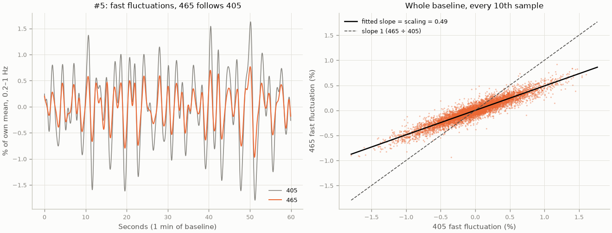

# How the fast-band 405 → 465 fit works

This walks through the fit used in the [13-h fit report](../reports/2026-11-03_13h_fitted_ne_level_spectra.md) (`python -m spectra.run_first5h_fit`). It goes from one raw 405/465 pair to the fitted NE level, one function at a time. The report explains why the fit is built this way. This page explains what the code does.

Each step shows the real values for mouse #5 (PFC fiber). To print them for any mouse and redraw the figure below:

```
python -m spectra.fit_walkthrough --mouse "#5"      # or "#3", "FP1", ...; add --fiber oc for the OC fiber
```

## The pipeline at a glance

```
TDT tank (465A/405A, ~1017 Hz)
  └─ MATLAB, once per recording:  load_pfc_raw → process_ne_session (crop to 5 h, downsample ×50)
       └─ outputs/ne_pfc_ds20_first5h/<recording>.mat   (raw 465 + 405 at ~20 Hz)
            └─ Python: run_first5h_fit.analyse()
                 load → windows → fast_band_gain → scaled_control → ΔF/F → level_pct
```

## Stage 1: extraction (MATLAB, `extraction/`)

Run once per recording with `sbatch extraction/run_extract_ne_pfc_first5h.sbatch`.

**`load_pfc_raw`** ([`load_pfc_raw.m`](../extraction/load_pfc_raw.m)) reads the 465A and 405A streams from the TDT tank (465C/405C for the OC fiber). The sampling rate (~1017.3 Hz) comes from the recording's own index file and is never hardcoded.

**`process_ne_session`** ([`process_ne_session.m`](../extraction/process_ne_session.m)):

- Crops each session to its first 5 h.
- Downsamples ×50 to ~20.35 Hz with its `ds` helper, which calls MATLAB's `resample` with an anti-aliasing filter. Nothing is lost: the recorded signal already rolls off around 6 Hz, below the new ~10 Hz limit.
- Also runs a robust fit over the whole 5 h and saves a ΔF/F (`dff`). **The fit described here ignores both.** It uses only the raw `signal_465` and `signal_405` traces from the file.

## Stage 2: the fit (Python, `spectra/`)

**Step 0, `load()`** ([`run_first5h.py`](run_first5h.py)) reads the .mat file and builds a time axis in minutes from the recording start.

> #5: 366,191 samples at 20.345 Hz, 0 to 300 min, injection at 59.4 min.

**Step 1, `windows()`** ([`sessions.py`](sessions.py)) defines the time windows:

- **Baseline:** from 5 min after the recording starts to 3 min before the injection. This skips the start-up period and the moment the mouse is picked up.
- **After the injection:** the first 20 min are skipped (handling spike), then 60-min blocks.

> #5: baseline 5.0 to 56.4 min. Baseline means are 465 = 247.0 and 405 = 180.0 (raw TDT units).

**Steps 2–4, `core.fast_band_gain()`** ([`core.py`](core.py)) learns the scaling. It is four lines and is the heart of the method. It uses the baseline window only:

| Line | What it does | Why | #5 |
|---|---|---|---|
| `y465 / np.mean(y465)` (same for 405) | Divides each channel by its own mean | Puts both channels in % units, so mice of different brightness can be compared | |
| `signal.butter(4, [0.2, 1.0], btype="band", ...)` | Builds a 4th-order Butterworth band-pass filter, 0.2–1 Hz | Keeps only fast fluctuations, where NE contributes little (the sensor is too slow, and the NE dips last ~1 min) | |
| `signal.sosfiltfilt(sos, ...)` | Applies the filter forward and then backward | No time shift, so the two channels stay aligned | 465 fluctuates 0.24%, 405 0.46%, correlation 0.94 |
| `np.dot(xx, yy) / np.dot(xx, xx)` | Least-squares slope of 465 on 405, through zero | The filtered signals average to zero, so no intercept is needed | **scaling = 0.488** |

So the scaling means: when 405 moves 1% for reasons unrelated to NE, 465 moves 0.49%.



*Figure 1. #5's baseline, both channels band-passed to 0.2–1 Hz. Left: one minute. The two channels move in lockstep, and 465 moves about half as much as 405. Right: 465 against 405 over the whole baseline, with the fitted slope (the scaling) and slope 1, which is what dividing 465 by 405 would assume.*

For contrast, ordinary least-squares fits on the same mouse, without the band-pass:

| Fit | Scaling | What pulls it |
|---|---|---|
| Baseline only | 0.74 | NE dips line up with 405 dips and pull the slope up |
| Whole 5 h | −0.14 | Over hours, 405 bleaches down while 465 rises after glucose, which pulls the slope negative |
| Robust whole-5-h fit from the extraction | −0.17 | Same as the whole-5-h fit |
| **Fast band, baseline (used)** | **0.49** | Movement and blood-flow artifacts, little NE |

**Step 5, `core.scaled_control()`** ([`core.py`](core.py)) builds the control from the whole 405 trace:

```
control = 465_baseline_mean × (1 + scaling × (405 / 405_baseline_mean − 1))
#5:     = 247.0 × (1 + 0.488 × (405 / 180.0 − 1))
```

When 405 sits at its baseline, the control equals the 465 baseline. When 405 drops 10%, the control drops 4.9%. Written as the usual straight line, control = a × 405 + b, this is a = scaling × 465 baseline ÷ 405 baseline = 0.669 and b = 465 baseline × (1 − scaling) = 126.6. Both forms are in `results/spectra_first5h_fit/fits.csv` (`gain`, `slope_raw_units`, `intercept_raw_units`).

**Step 6, `core.fast_band_fit_dff()`** ([`core.py`](core.py)) wraps steps 2–5 and computes ΔF/F = 100 × (465 − control) / control.

> #5: the baseline ΔF/F averages −0.01%, which is ≈ 0 by design.

**Step 7, `level_pct()`** ([`run_first5h_fit.py`](run_first5h_fit.py)) gives the NE level numbers in the report's Table 1. It takes the mean of 465 ÷ control in a window, relative to the same ratio over the baseline.

> #5 over +20–140 min: raw 405 is −12.7%, so the control is 0.488 × −12.7% ≈ **−6.2%**. Raw 465 is **+12.6%**. Fitted level = 1.126 ÷ 0.938 − 1 ≈ **+20.1%**.

In words: the fit takes the 405 drop and counts 49% of it as the non-NE part of 465. 465 is then measured against that lower floor, so its rise is larger than in the raw trace.

## What else `analyse()` computes

All in [`run_first5h_fit.py`](run_first5h_fit.py), from the same functions:

- **Checks on the scaling:** `fast_band_gain` re-run on 0.1–1 Hz, 0.5–1 Hz, the 0.01–0.05 Hz dip band, and the +20–140 min window. Written to `fits.csv`.
- **Sensitivity** (report Appendix A): `scaled_control` and `level_pct` re-run for every scaling from 0 to 1.2 in steps of 0.05. Written to `scaling_sensitivity.csv`.
- **Band power** (report Appendix B): `core.window_spectra` and `core.band_power` on the fitted ΔF/F, the same spectral code as the first 13-h report. Written to `band_power.csv`.

## FAQ

**Why not fit 405 to 465 by least squares on the raw traces, as usual?**
Least squares is pulled toward whichever time scale has the biggest swings, and here those swings are NE. On the baseline it is the NE dips, which line up with 405 dips. On the whole session it is the glucose rise in 465 against 405 bleaching. The contrast table above shows the effect for #5: 0.74 and −0.14, against 0.49 from the fast band. A control that has partly fitted NE removes part of the NE signal.

**Why the 0.2–1 Hz band?**
Here 465 and 405 move together (coherence 0.7–0.9 in most mice), and NE contributes little: the GRAB-NE sensor is too slow, and the NE dips are much slower. Other fast bands (0.1–1 and 0.5–1 Hz) give the same scaling within 0.03 in 7 of 9 mice, and so does the window after the injection (0.41–0.58, against 0.38–0.49 at baseline).

**Where is the intercept?**
It is fixed by anchoring rather than fitted: the control equals the 465 baseline mean whenever 405 sits at its baseline mean. That is why the baseline ΔF/F is 0 by design. The equivalent raw-unit intercept is b in step 5.

**What does a scaling of 0 or 1 mean?**
0 is no correction: the fitted level is the raw 465 level. 1 assumes 465 loses the same fraction of light as 405, which is the same as dividing 465 by 405. The fast-band values (~0.4–0.5) are in between. The ratio was rejected because saline 405 falls 13–17% by the last hour while 465 falls only 3–6%, so dividing would make saline mice appear to rise.

**What is the main assumption?**
That slow non-NE light changes (bleaching, and the extra 405 drop after glucose) carry over to 465 with the same scaling as the fast fluctuations. Nothing in the data measures the slow scaling directly. Appendix A of the report shows how much each mouse's level depends on it. The order of the mice holds across the plausible range.

**Is the control smoothed, as in the lab's MATLAB pipeline?**
No. The lab's pipeline smooths the control with a 1-s moving average; this one doesn't, so 405's fast noise passes into the ΔF/F. That doesn't matter for the level, which is a mean over an hour or more. The fitted ΔF/F is not used for spectra above 0.05 Hz, where the "not shared with 405" measure from the first report stays the one to use.

**Why does the fit change glucose mice more than saline mice?**
Their 405 falls more after the injection: −10 to −15% over +20–140 min, against −7 to −9% for saline. The control falls with 405, so a larger 405 drop means a larger upward correction of 465.

**Why can't some mice be decided, such as #22?**
If a mouse's scaling depends on the band, its fit can't be trusted. #22 gives 0.88 at 0.2–1 Hz, 0.98 at 0.1–1 Hz, 0.43 at 0.5–1 Hz, and 0.48 after the injection, and its level flips sign at a scaling of about 0.55. It is the dimmest recording, so much of its fast 405 signal is detector noise rather than shared light changes. Comparing the `gain_*` columns of `fits.csv` is the check to run on any new mouse.

**How do I check a number in the report?**
Run `python -m spectra.fit_walkthrough --mouse "<mouse>"`. Step 4 should match the mouse's `gain` in `fits.csv`, and step 7 should match its `fitted_pct` for the "+20-140 min" window in `level.csv`.
